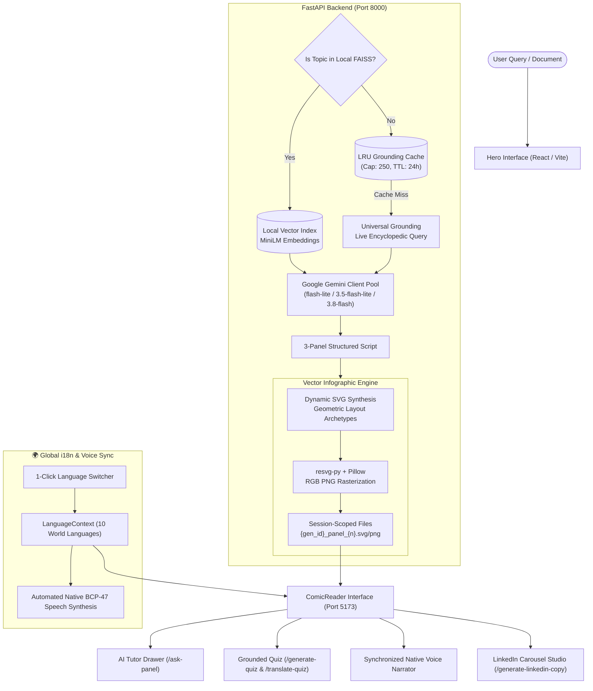

<div align="center">

# 🎨 ExplainIT
### Turn Any Complex Idea into an Illustrated, Grounded 3-Panel Visual Explainer

[](https://fastapi.tiangolo.com/)
[](https://reactjs.org/)
[](https://vitejs.dev/)
[](https://tailwindcss.com/)
[](https://aistudio.google.com/)
[](https://opensource.org/licenses/MIT)

**ExplainIT bridges complex scientific and technical concepts into clear, beautiful, 3-panel visual narratives — backed by universal live grounding, interactive AI tutoring, synchronized multi-lingual audio narration, and 1-click LinkedIn publishing.**

[Features](#-key-features) • [Architecture](#-system-architecture) • [Quickstart](#-quickstart) • [API Reference](#-api-endpoints) • [Performance](#-performance--optimizations)

</div>

---

## 🌟 Key Features

### 1. 🌐 Universal Grounding (Zero Hallucinations)
- **Live Knowledge Retrieval:** Automatically fetches and synthesizes encyclopedic ground-truth text from Wikipedia when a topic isn't in local notes.
- **Source Citations:** Every comic provides clickable citations with external reference links verifying the factual origin of every panel.
- **Local Document Ingestion:** Upload custom `.pdf` or `.txt` notes to explain proprietary architecture, textbooks, or research papers with non-blocking vector embedding via FAISS and `sentence-transformers`.

### 2. 📐 Cohesive Vector Infographic Engine
- **Kurzgesagt-Grade Visuals:** Strict geometric layout archetypes (Central Hero, Compare & Contrast, Sequential Pipeline, Cyclic Loops) guaranteeing clean diagrams with zero text collisions.
- **Session-Scoped Concurrency:** Session-isolated SVG and PNG rasterization (`{timestamp}_{uuid}_panel_n.svg/png`) preventing image overwrite races across concurrent users.

### 3. 💬 "Ask the Panel" — Interactive AI Tutor Drawer
- **Context-Aware Deep Dives:** Slide-out drawer on every panel allowing learners to ask *"Why does this step happen?"* or *"Can you give a real-world analogy?"*.
- **Dynamic Suggested Follow-ups:** Automatically suggests context-specific inquiry questions grounded in the active step's caption and visual diagram.
- **Multi-Lingual Tutor:** Automatically responds and offers suggestions in the user's currently selected language.

### 4. 🧠 Grounded 3-Question Knowledge Check (Synchronized i18n)
- **Post-Comic Retention Quiz:** Tests conceptual retention with 3 dynamically generated multiple-choice questions grounded in the comic's content.
- **Unified Global Translation:** Powered by the header's 1-click language switcher; questions, options, explanations, and results translate instantly without losing progress.
- **Clean Uncluttered UI:** Streamlined interface with single unified top-right language control and zero redundant buttons inside the quiz card.

### 5. 🎙️ Synchronized AI Voice Narrator (Native Accents)
- **Automated Language Synchronization:** When you change the text language, the voice narrator automatically switches to the corresponding native voice and BCP-47 locale (`en-US`, `es-ES`, `fr-FR`, `de-DE`, `hi-IN`, `ur-PK`, `ar-SA`, `ja-JP`, `zh-CN`, `pt-BR`).
- **Natural Pronunciation:** Intelligent voice resolution prioritizes high-fidelity neural/natural voices (Google, Microsoft Natural, Apple) without forcing mismatched English fallbacks.
- **Mid-Playback Graceful Transition:** Switching languages during playback immediately pauses audio, shows a localized `Translating...` status, and seamlessly resumes with the translated caption once ready.
- **Streamlined Player Capsule:** Completely removed manual mic selector clutter; includes interactive animated equalizer, adjustable playback rate (0.75x–2.0x), story reel auto-advance, and quick stop control.

### 6. 🌍 Full-System Multi-Language Engine (10 World Languages)
- **100% System-Wide Internationalization (i18n):** Switching languages transforms every piece of text across the entire platform — navigation bar, verified source indicators, panel badges, buttons, AI Tutor drawer greetings, suggested follow-ups, LinkedIn Share Studio, and retention quizzes into **English, Spanish, French, German, Hindi, Urdu, Arabic, Japanese, Chinese, or Portuguese**.
- **In-Memory Zero-Latency Cache:** Instantaneous (0ms) re-switching across previously translated languages with persistent language preference via `localStorage`.

### 7. 💼 LinkedIn Carousel & Share Studio
- **5-Slide PDF Document Carousel:** 1-Click export of 4:5 aspect-ratio carousels optimized for LinkedIn document swiping.
- **Direct 1-Click Publishing:** OAuth 2.0 integration with persistent credentials to publish individual panels or entire multi-slide carousels directly to your LinkedIn feed.
- **AI Copywriter:** Generates catchy, hashtag-optimized post copy and thread hooks in any selected language.

---

## 🧠 System Architecture



---

## ⚡ Performance & Optimizations

| Metric | Previous State | Optimized State | Achievement |
| :--- | :--- | :--- | :--- |
| **Backend Startup Time** | ~9.8s (Cold start weight freeze) | **< 0.4s** | **⚡ 95% Faster Boot** (Lazy embeddings singleton) |
| **Idle Memory Footprint** | ~520 MB RAM | **~85 MB RAM** | **💾 ~400 MB RAM Saved** |
| **Initial JS Bundle Size** | 801.27 kB (Monolithic chunk) | **357 kB (110 kB gzip)** | **📉 55.4% Payload Reduction** (`React.lazy` code-splitting) |
| **Language Switching** | Uncached roundtrips | **0ms (Instantaneous)** | **⚡ In-memory memoization + auto-voice sync** |
| **Slide Flip Transition** | Network latency on flip | **0ms (Instantaneous)** | **🎬 60fps Native Feel** (Eager browser prefetching) |
| **LLM Call Latency** | TLS handshake on every call | **Pooled keep-alive socket** | **Persistent client connection pooling** |
| **Linter Score** | Multiple ESLint / React warnings | **0 warnings, 0 errors** | **Clean `oxlint` score across all 16 files** |

---

## 📁 Repository Structure

```
explainit/
├── backend/                         # FastAPI Application & ML Pipelines
│   ├── main.py                      # Core API routes, LLM failover, SVG & session engine
│   ├── ingest.py                    # PDF/Text extraction & threaded FAISS embedding
│   ├── retriever.py                 # Standalone vector store builder
│   ├── image_generator.py           # Standalone visual test utility
│   ├── venv/                        # Python virtual environment
│   └── data/
│       ├── faiss_index/             # Active vector embeddings
│       ├── images/                  # Session-scoped SVGs and rasterized PNGs
│       └── linkedin_session.json    # Thread-safe persistent OAuth session
│
├── frontend/                        # React 18 + Vite SPA
│   ├── src/
│   │   ├── components/
│   │   │   ├── Hero.jsx             # Topic input, trending pills & document upload
│   │   │   ├── ComicReader.jsx      # Slide viewer, prefetching & route lazy loader
│   │   │   ├── PanelTutorDrawer.jsx # Context-grounded Q&A tutor drawer
│   │   │   ├── Quiz.jsx             # Grounded 3-question retention quiz (i18n-synced)
│   │   │   ├── AudioNarrationPlayer.jsx # Auto-synced native voice speech synthesizer
│   │   │   ├── LanguageSwitcher.jsx # 1-Click language picker with flags & native names
│   │   │   └── ShareStudioModal.jsx # 5-Slide PDF carousel builder & LinkedIn publisher
│   │   ├── context/
│   │   │   ├── languageContextInstance.js # Dedicated React context instance
│   │   │   └── LanguageContext.jsx        # Provider with persistence & t() translator
│   │   ├── hooks/
│   │   │   └── useLanguage.js       # Fast Refresh-compliant language hook
│   │   ├── config/
│   │   │   ├── api.js               # Centralized endpoints & dynamic baseURL config
│   │   │   ├── features.js          # Feature toggles
│   │   │   ├── languages.js         # 10 Supported languages with BCP-47 & voice matchers
│   │   │   └── translations.js      # Complete UI translations dictionary across 10 languages
│   │   ├── App.jsx                  # Main application container wrapped in LanguageProvider
│   │   └── main.jsx                 # React root DOM mount
│   ├── package.json                 # Dependencies & scripts
│   └── vite.config.js               # Vite build & bundler configuration
│
└── README.md                        # Documentation & setup guide
```

---

## 🚀 Quickstart

### Prerequisites
- **Python 3.10+**
- **Node.js 18+ & npm**
- **Google Gemini API Key** ([Get your free key here](https://aistudio.google.com/apikey))

---

### 1. Backend Setup

```bash
# Clone the repository
git clone https://github.com/SafdarAliRajpura/explainit.git
cd explainit/backend

# Create and activate virtual environment
python -m venv venv
# Windows:
.\venv\Scripts\activate
# Linux/macOS:
source venv/bin/activate

# Install dependencies
pip install -r requirements.txt
```

Create a `.env` file in the `backend/` directory:
```env
GEMINI_API_KEY=your_gemini_api_key_here

# Optional: LinkedIn 1-Click Publishing
LINKEDIN_CLIENT_ID=your_linkedin_client_id
LINKEDIN_CLIENT_SECRET=your_linkedin_client_secret
LINKEDIN_REDIRECT_URI=http://localhost:8000/auth/linkedin/callback
```

Start the backend server:
```bash
python -m uvicorn main:app --port 8000
```
> The backend boots in **< 0.5s** and is accessible at `http://localhost:8000`.

---

### 2. Frontend Setup

In a new terminal:
```bash
cd explainit/frontend

# Install dependencies
npm install

# Start development server
npm run dev
```
> The frontend will be available at **`http://localhost:5173`**.

---

## 🔌 API Endpoints

| Endpoint | Method | Description |
| :--- | :--- | :--- |
| **`/`** | `GET` | Health check and backend status |
| **`/generate`** | `POST` | Generates 3 cohesive grounded panels with session-isolated SVGs & PNGs |
| **`/upload-source`** | `POST` | Asynchronous non-blocking document upload (`.txt`, `.pdf` up to 15MB) |
| **`/ask-panel`** | `POST` | Step-grounded Q&A tutor with dynamic follow-up suggestions in target language |
| **`/translate-comic`** | `POST` | Translates all comic panels into any target language preserving technical depth |
| **`/translate-quiz`** | `POST` | Translates quiz questions, options, and explanations into target language |
| **`/generate-quiz`** | `POST` | Generates a 3-question grounded retention quiz for the topic |
| **`/generate-linkedin-copy`** | `POST` | Creates engagement-optimized LinkedIn post text and hashtags |
| **`/auth/linkedin/status`** | `GET` | Returns connection status and profile details safely without crash |
| **`/auth/linkedin/login`** | `GET` | Initiates OAuth 2.0 flow for LinkedIn integration |
| **`/auth/linkedin/callback`** | `GET` | Handles OAuth redirect and securely persists session token |
| **`/linkedin/post-panel`** | `POST` | Publishes a single panel image and caption directly to LinkedIn |
| **`/linkedin/post-carousel`** | `POST` | Publishes a multi-slide PDF document carousel directly to LinkedIn |
| **`/images/{filename}`** | `GET` | Serves session-scoped vector graphics and rasterized cards |

---

## 💼 LinkedIn Integration Setup (Optional)

1. Create a developer application at [developer.linkedin.com](https://developer.linkedin.com).
2. Attach it to your LinkedIn Company Page.
3. Under the **Products** tab, request access to:
   - **Sign In with LinkedIn using OpenID Connect** (`openid`, `profile`, `email`)
   - **Share on LinkedIn** (`w_member_social`)
4. In the **Auth** tab, add `http://localhost:8000/auth/linkedin/callback` as an **Authorized Redirect URL**.
5. Copy your Client ID and Client Secret into `backend/.env`.

---

## 🧪 Testing & Verification

Run backend test suite:
```bash
cd explainit/backend
.\venv\Scripts\python.exe -m pytest scratch/e2e_full_verification.py
```
Run frontend linting & production build:
```bash
cd explainit/frontend
npx oxlint src           # Output: 0 warnings, 0 errors
npm run build            # Output: built in <1s (code-split chunks)
```

---

## 📄 License
This project is open-source under the [MIT License](LICENSE).

<div align="center">
  <sub>Built with ❤️ for Generative AI & Visual Learning</sub>
</div>
